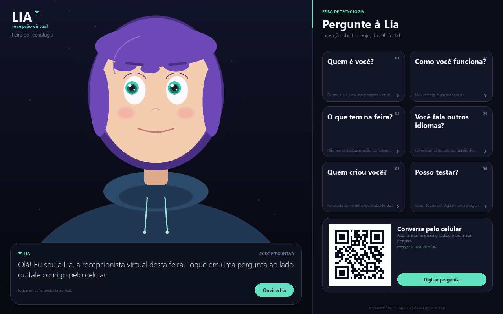

# Lia — recepcionista virtual para feiras e eventos



A **Lia** é uma recepcionista virtual feita em Python para ficar em um totem
(computador ou TV touch) na entrada de uma feira. Ela conversa com o visitante,
responde em voz alta e anima o próprio rosto — **sem microfone**.

O visitante pode interagir de três formas:

1. **tocar em uma pergunta pronta** na tela (resposta instantânea);
2. **digitar** no teclado da tela ou em um teclado físico;
3. **escaneiar o QR code** e conversar pelo próprio celular.

O modo padrão não abre microfone nem carrega o Whisper: em um salão cheio, isso
é mais confiável, mais rápido e preserva a privacidade de quem passa.

```
pergunta pronta / teclado / celular
                 |
                 v
        LLM gratuito (texto)  ->  frases  ->  Kokoro-TTS  ->  alto-falante
                                                |
                                  envelope de volume (100 Hz)
                                                |
                                        boca do avatar
```

## O que já vem pronto

- **Totem completo**: cartões de perguntas, teclado na tela, legendas com efeito
  de digitação, botão de parar, retorno automático ao descanso.
- **QR code para o celular**: uma página web local, embutida no próprio Python,
  onde o visitante digita a pergunta e vê a resposta do totem.
- **Voz local com Kokoro-TTS** em português do Brasil e boca sincronizada com o
  áudio.
- **Cache de voz**: as respostas prontas tocam na hora nas próximas execuções.
- **Personagem desenhada em código**, sem assets externos.
- **Câmera opcional**: cumprimenta quando detecta um rosto (os quadros são
  descartados, nada é gravado).
- **Modo microfone opcional**, com Whisper, para quem quiser a experiência
  original de conversa por voz.
- **LLM gratuito**: Pollinations por padrão (sem cadastro e sem chave) ou Ollama
  local para ser realmente ilimitado.

## Requisitos

- Python **3.10–3.12** (testado no 3.12)
- Windows, macOS ou Linux
- 8 GB de RAM (16 GB deixa confortável)
- Caixa de som ou TV com áudio
- Internet para o LLM na nuvem (ou Ollama local)
- Opcional: webcam para detectar presença
- Opcional: microfone, apenas no modo `--microfone`

Não precisa de placa de vídeo. O desenho e a voz rodam na CPU.

## Instalação

### Windows (um comando)

```powershell
powershell -ExecutionPolicy Bypass -File instalar.ps1
```

O script cria o `.venv`, instala o PyTorch de CPU e as demais dependências.

### Manual (qualquer sistema)

```powershell
python -m venv .venv
.venv\Scripts\Activate.ps1        # Linux/macOS: source .venv/bin/activate
python -m pip install torch --index-url https://download.pytorch.org/whl/cpu
python -m pip install -r requirements.txt
```

No Linux, se o áudio reclamar:

```bash
sudo apt install libportaudio2 espeak-ng
```

No macOS, use `brew install portaudio` se necessário.

### Primeiro teste

```powershell
python verify.py
```

O teste valida as perguntas, o LLM, o Kokoro, a saída de áudio, o avatar, a
interface do totem e a página do celular. As amostras ficam em `out/`.

Na primeira execução, o Kokoro baixa cerca de **350 MB** e a Lia prepara a voz
das perguntas padrão (cerca de 1 a 2 minutos em CPU). Isso fica salvo em
`cache/voz/`; depois disso o totem abre em menos de um segundo.

Se tudo passar:

```powershell
python run.py
```

## Operando na feira

Por padrão a Lia abre em **1280×800**, em janela. Para o totem:

```powershell
python run.py --fullscreen
```

| Ação | Como |
| --- | --- |
| Responder uma pergunta pronta | toque no cartão |
| Digitar | toque em **Digitar pergunta** ou comece a digitar no teclado físico |
| Enviar | **Enter** ou botão **ENVIAR** |
| Fechar o teclado | **Esc** ou botão **×** |
| Voltar ao início | **Esc** na conversa, ou aguardar 90 s sem interação |
| Tela cheia | **F11** |
| Sair do programa | **Ctrl+Q** |

O totem volta sozinho para a tela de descanso depois de `LIA_INATIVIDADE`
segundos (padrão: 90). Assim o próximo visitante sempre encontra a recepção
limpa, sem a conversa da pessoa anterior.

### Celular pelo QR code

O QR code aparece no canto inferior do totem. Ele aponta para uma página servida
pelo próprio computador na rede local (porta 8765 por padrão):

- o celular precisa estar na **mesma rede Wi-Fi** do totem;
- se a porta estiver ocupada, a Lia tenta as próximas e atualiza o QR;
- a página não usa internet nem CDN — tudo é servido localmente;
- a pergunta digitada no celular aparece no totem e a resposta é falada em voz
  alta, como se a pessoa estivesse na frente da tela.

Se você for usar um domínio ou túnel (Cloudflare Tunnel, por exemplo), defina a
URL pública no `.env` para o QR apontar para ela:

```env
LIA_WEB_URL=https://seu-tunel.exemplo.com
```

Para desligar a página do celular:

```powershell
python run.py --sem-web
```

### Webcam de presença (opcional)

Com uma webcam, a Lia pode cumprimentar quem chega. A detecção usa o
classificador Haar do OpenCV, roda em uma thread separada e **não grava nem
envia imagens**:

```powershell
python run.py --camera
```

Sem webcam ou sem OpenCV, o totem continua normal — apenas não cumprimenta
sozinho.

### Sem áudio (opcional)

Para um totem só de texto, sem baixar o Kokoro:

```powershell
python run.py --sem-audio
```

## Personalizando o evento

As perguntas ficam em `perguntas.json`, na raiz do projeto. Edite e reinicie o
totem (não é preciso reinstalar nada):

```json
{
  "evento": "Feira de Tecnologia",
  "subtitulo": "Inovação aberta · hoje, das 9h às 18h",
  "boas_vindas": "Olá! Eu sou a Lia, a recepcionista virtual desta feira. Toque em uma pergunta ao lado ou fale comigo pelo celular.",
  "convite": "Pode perguntar à vontade.",
  "perguntas": [
    {
      "titulo": "Quem é você?",
      "pergunta": "Quem é você?",
      "resposta": "Eu sou a Lia, uma recepcionista virtual feita em Python. Funciono sem microfone: você escolhe uma pergunta na tela ou conversa comigo pelo celular."
    }
  ]
}
```

Regras práticas:

- até **6 perguntas** aparecem nos cartões;
- `titulo` é o texto curto do cartão; `pergunta` é o que fica registrado na
  conversa e no histórico;
- `resposta` é falada e exibida — escreva frases curtas, sem markdown, emojis
  ou listas;
- prefira respostas de 2 a 4 frases; respostas longas demoram para começar;
- não coloque dados pessoais, senhas ou informações que mudam toda hora.

Para usar outro arquivo:

```powershell
python run.py --perguntas C:\caminho\meu-evento.json
```

Na primeira vez que uma resposta nova é usada, a voz é gerada e guardada em
`cache/voz/`. Nas próximas, toca instantaneamente.

## Cache de voz

O cache fica em `cache/voz/*.wav` e é indexado por **voz + velocidade + texto**.
Isso significa que:

- respostas prontas e a saudação tocam sem espera depois da primeira execução;
- mudar `LIA_VOZ` ou `LIA_VELOCIDADE` cria novas entradas sem apagar as antigas;
- para forçar a regeneração, apague a pasta `cache/voz/`;
- o áudio é local e não sai do computador.

Quando o cache já existe, o totem abre rápido e aquece as vozes que faltam em
segundo plano, 6 segundos depois de iniciar. Na primeira execução (cache vazio),
a preparação é feita antes, com uma tela de progresso.

## Escolhendo o "cérebro"

| Provedor | Chave? | Custo | Observação |
| --- | --- | --- | --- |
| `pollinations` (padrão) | não | grátis | funciona na hora; uso anônimo tem limite/fila |
| `ollama` | não | grátis | **ilimitado de verdade**, roda offline, precisa de RAM |
| `groq` | sim | plano gratuito | muito rápido e bom em português |
| `gemini` | sim | plano gratuito | boa qualidade |
| `custom` | — | — | qualquer endpoint compatível com OpenAI (LM Studio etc.) |

> Nenhum serviço na nuvem é realmente ilimitado: os gratuitos têm limites de
> uso. Para um evento de um dia inteiro, o Ollama local é a opção mais segura.

### Ollama (local e ilimitado)

```powershell
winget install Ollama.Ollama      # ou baixe em ollama.com
ollama pull qwen2.5:3b            # ~2 GB, bom em português e leve
ollama serve
```

Copie `.env.example` para `.env` e descomente:

```env
LIA_PROVIDER=ollama
OLLAMA_MODEL=qwen2.5:3b
```

Com 16 GB de RAM, `qwen2.5:7b` ou `llama3.1:8b` também rodam (mais lentos sem
GPU; a Lia já começa a falar antes da resposta terminar).

## Modo microfone (opcional)

O modo original, com microfone e Whisper, continua disponível:

```powershell
python run.py --microfone
```

| Tecla | Ação |
| --- | --- |
| falar | a Lia detecta o fim da frase sozinha e responde |
| `Espaço` | falar agora / encerrar a fala / interromper a Lia |
| `M` | liga/desliga a escuta contínua |
| `F` | tela cheia |
| `C` | limpar as legendas |
| `Esc` | interromper a fala ou sair |

Na primeira vez, o Whisper baixa cerca de 460 MB em `models/`. Em um evento com
ruído, porém, o modo totem (padrão) costuma ser bem mais confiável.

Para conversar digitando no terminal, sem microfone:

```powershell
python run.py --texto
```

## Ajustes úteis

Tudo pode ir no `.env` (copie de `.env.example`) ou como variável de ambiente.

| Variável | Padrão | Para quê |
| --- | --- | --- |
| `LIA_MODO` | `totem` | `totem`, `microfone` ou `texto` |
| `LIA_PERGUNTAS` | `perguntas.json` | arquivo do evento |
| `LIA_WEB` | `1` | liga a página do celular |
| `LIA_WEB_PORT` | `8765` | porta inicial do servidor local |
| `LIA_WEB_URL` | — | URL pública opcional para o QR |
| `LIA_INATIVIDADE` | `90` | segundos até voltar ao descanso |
| `LIA_CAMERA` | `0` | liga a webcam de presença |
| `LIA_CAMERA_INDICE` | `0` | índice da webcam |
| `LIA_SAUDACAO` | `1` | cumprimenta sozinha ao iniciar |
| `LIA_AUDIO` | `1` | voz do totem (0 = só texto) |
| `LIA_PERSONA` | Lia, 3 frases, sem markdown | personalidade e regras |
| `LIA_VOZ` | `pf_dora` | voz do Kokoro |
| `LIA_VELOCIDADE` | `1.0` | velocidade da fala |
| `LIA_LARGURA` / `LIA_ALTURA` | `1280` / `800` | janela |
| `LIA_ESCALA` | `2` | qualidade do desenho (1 = mais leve) |
| `LIA_FULLSCREEN` | `0` | abrir em tela cheia |
| `LIA_WHISPER` | `small` | modelo do modo microfone |
| `LIA_SILENCIO` | `0.8` | silêncio que encerra a fala |
| `LIA_MAX_FALA` | `20` | duração máxima de uma fala |
| `LIA_MIC_GAIN` | `1.0` | ganho do microfone |

### Flags da linha de comando

```text
--totem          modo feira, sem microfone (padrão)
--microfone      modo voz original, com microfone e Whisper
--texto          conversar digitando no terminal
--camera         cumprimentar quando detectar um rosto
--porta N        porta da página do celular
--sem-web        desligar a página do celular e o QR code
--sem-audio      totem sem voz (não baixa o Kokoro)
--perguntas F    arquivo JSON com as perguntas do evento
--janela         abrir em janela mesmo se LIA_FULLSCREEN=1
--fullscreen     iniciar em tela cheia
--voz NOME       pf_dora, pm_alex ou pm_santa
--escala 1|2|3   qualidade do desenho
--provider NOME  pollinations, ollama, groq, gemini ou custom
--vozes          listar as vozes e sair
```

## Estrutura

```
run.py             inicia a Lia
verify.py          teste de fumaça (LLM, voz, avatar, totem e página do celular)
perguntas.json     perguntas e textos do evento
instalar.ps1       instalação no Windows
lia/
  app.py           linha de comando e modos (totem, microfone, texto)
  kiosk.py         interface do totem, cartões, teclado, cache e conversa
  webserver.py     página do celular, QR e endpoints
  presence.py      webcam opcional de presença
  avatar.py        personagem desenhada, olhos, piscadas e boca
  audio.py         microfone com VAD, tocador e envelope de lipsync
  llm.py           streaming de texto com fallback entre provedores
  stt.py           faster-whisper (modo microfone)
  tts.py           Kokoro-TTS e limpeza do texto para fala
  texto.py         divisão de frases para falar durante o streaming
  config.py        .env, persona, provedores e ajustes
cache/voz/         áudio das respostas (gerado automaticamente)
models/            modelos baixados (modo microfone)
out/               amostras geradas pelo verify.py
```

## Como o lipsync funciona

O Kokoro devolve o áudio da frase. A Lia calcula um **envelope de volume**
(RMS em janelas de 10 ms), converte para uma escala de dB e o resultado abre e
fecha a boca quadro a quadro, com ataque rápido e fechamento suave. O índice do
envelope é lido da **posição real de reprodução** do sounddevice, então não há
dessincronização mesmo com frases longas.

É a mesma ideia usada por bibliotecas de visemes (energia da fala → abertura de
boca), só que sem alinhamento forçado. Se quiser formas de boca por fonema
(aa/ee/oo/mm), o gancho natural é o `result.phonemes` que o Kokoro devolve em
`lia/tts.py` + um alinhador (WhisperX ou Rhubarb Lip Sync).

## Privacidade

- No modo totem, **o microfone não é aberto** e o Whisper não é carregado.
- A webcam opcional lê os quadros, conta rostos e **descarta a imagem**; nada é
  gravado ou enviado.
- A voz é gerada na máquina; nenhum áudio sai do computador.
- Apenas o texto da pergunta é enviado ao provedor de LLM escolhido. Com Ollama,
  nada sai da máquina.
- A página do celular serve apenas a rede local; não há analytics nem cookies.

## Problemas comuns

**O QR code não abre no celular.** Confirme que o celular está na mesma rede
Wi-Fi e que o firewall do Windows permite o Python na rede privada. Se a rede
bloquear a comunicação entre dispositivos, use um túnel e defina `LIA_WEB_URL`.

**A primeira execução demora.** O Kokoro baixa ~350 MB e gera a voz das respostas
padrão. As próximas aberturas usam `cache/voz/` e são quase instantâneas.

**A voz não toca.** Veja se o dispositivo de saída está correto e rode
`python verify.py`. Para um totem só de texto, use `--sem-audio`.

**O LLM devolve 429/503.** O plano anônimo do Pollinations enfileira. Configure
`GROQ_API_KEY`, `GEMINI_API_KEY` ou use Ollama.

**A webcam não é encontrada.** Teste `--camera` com outra entrada em
`LIA_CAMERA_INDICE=1`. Sem OpenCV, o modo presença é simplesmente desligado.

**Erro de `CascadeClassifier` no OpenCV.** O OpenCV 5 removeu essa API. O
`requirements.txt` fixa `opencv-python-headless>=4.8,<5`; reinstale as
dependências se tiver atualizado manualmente.

**A tela do evento é maior que a janela.** Use `--fullscreen` ou ajuste
`LIA_LARGURA` e `LIA_ALTURA`. O layout também funciona em pé (retrato), útil para
totens verticais.

**Quero trocar a voz.** `python run.py --voz pm_alex` (masculina) ou
`pm_santa` (masculina grave). A primeira fala de cada resposta nova é gerada na
hora; depois entra no cache.

## Créditos

- [Kokoro-TTS](https://github.com/hexgrad/kokoro) — voz local em português
- [Pollinations](https://pollinations.ai) — LLM gratuito sem chave
- [Ollama](https://ollama.com) — LLM local
- [Pygame](https://www.pygame.org) — interface e personagem
- [faster-whisper](https://github.com/SYSTRAN/faster-whisper) — modo microfone
- [qrcode](https://github.com/lincolnloop/python-qrcode) — QR code
- [OpenCV](https://opencv.org) — detecção de presença opcional

## Licença

MIT. Veja [LICENSE](LICENSE).
